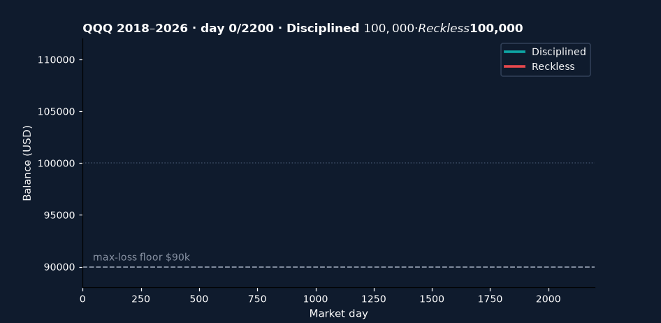
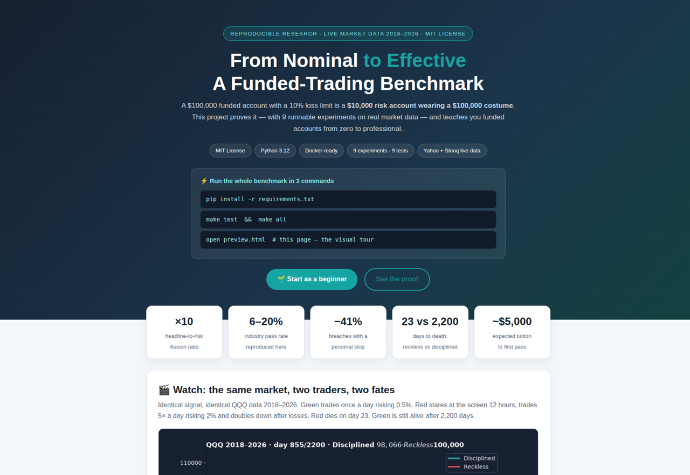
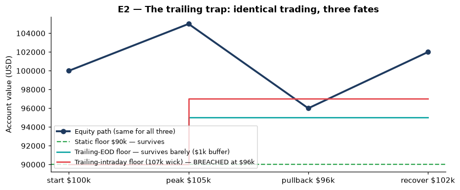
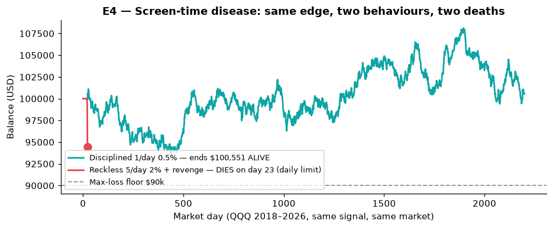
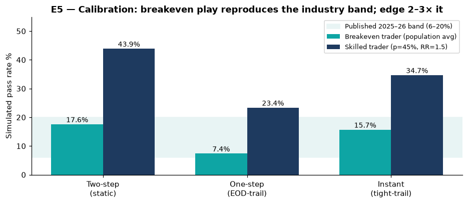
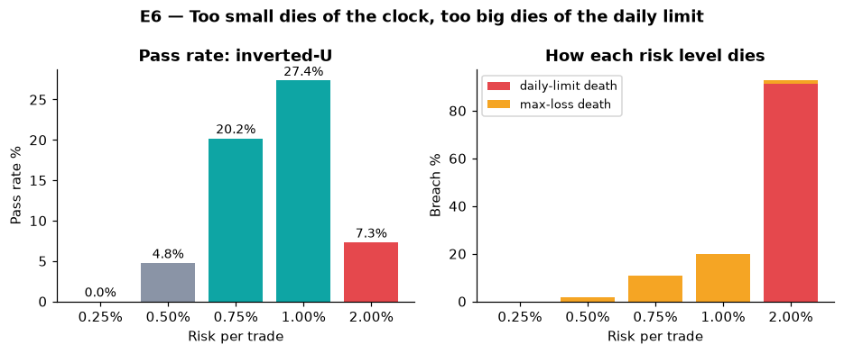

# From Nominal to Effective — Funded-Trading Benchmark 2026


**An open, reproducible laboratory that measures retail funded-trading accounts — and teaches them from zero to professional.**

> **CEO summary (read this in 60 seconds).**
> A $100,000 funded account with a 10% loss limit is a **$10,000 risk account wearing a $100,000 costume** — and every fee, target and risk decision should be priced on the $10,000, never the headline.
> Across 9 experiments on live 2018–2026 market data we show: (1) identical trading survives under a static loss floor but dies under an intraday-trailing one; (2) a personal stop at half the firm's daily limit cuts account deaths by ~41%; (3) a calm trader (1 trade/day, 0.5% risk) survives 2,200 days where a 12-hour screen-starer (5 trades/day, 2%, revenge sizing) dies on day 23 — same signal, same market; (4) our simulator reproduces the industry's published 6–20% pass band from a breakeven trader, proving the rules filter skill rather than run a lottery; (5) expected tuition to the first pass is ~$5,000 in fees, so beginners should budget — never borrow.
> Everything regenerates with one command. When you finish this page, you will understand funded accounts better than most paid-course graduates.



*☝️ Auto-playing demo: green = disciplined (alive after 2,200 days), red = reckless (dead day 23). Generated from verified backtest output. Video version: [docs/demo.mp4](docs/demo.mp4). Visual tour: [preview.html](preview.html).*

```bash
pip install -r requirements.txt
make test && make all        # 9 tests + 9 experiments -> results/*.json
make media                    # rebuild every figure + demo from results
```

## Table of contents

- [🌱 Beginner guide — read this and you are a professional](#-beginner-guide--read-this-and-you-are-a-professional)
- [👥 Who is this for — pick your story](#-who-is-this-for--pick-your-story)
- [✨ Features](#-features)
- [🔬 The proof — experiments E1–E9](#-the-proof--experiments-e1e9)
- [💡 Hidden patterns](#-hidden-patterns)
- [🗂 Repository map](#-repository-map)
- [📡 Data provenance](#-data-provenance)
- [🚀 Reproduce everything](#-reproduce-everything)
- [⚠️ Honest limits](#️-honest-limits)
- [🎓 From benchmark to PhD paper](#-from-benchmark-to-phd-paper)
- [❓ FAQ](#-faq)
- [🛡 Ethics & risk](#-ethics--risk)
- [📚 References](#-references)
- [📜 Citation & license](#-citation--license)

---

## 🌱 Beginner guide — read this and you are a professional

*Seven ideas. Each one saves beginners months of losses. Each one is proven by an experiment below with real market data.*

**1. Your account is smaller than you think.**
A $100k account with a 10% loss limit gives you **$10,000 of real risk money** — the other $90,000 is scenery. An "8% profit target" is really an **80% sprint on your risk money**. Always compare accounts by risk money, never by headline size. → *Experiment E1.*

**2. Profit can kill you under trailing rules.**
Some accounts **raise your loss floor every time you make money** — a winning week leaves you *less* room to breathe. Beginners should choose accounts with a fixed (static) floor. → *Experiment E2.*

**3. The daily limit is the real boss.**
Most accounts die in **one single bad day**, not slowly. Set your *own* stop at **half the firm's limit** and close the laptop when it hits — account deaths drop ~41% in simulation. → *Experiment E3.*

**4. Staring at charts 12 hours a day is the disease.**
Five trades a day at 2% risk with revenge-doubling dies in days; one calm trade a day at 0.5% risk survives for years — on the **same market with the same signal**. Frequency × size × revenge is the killer, not the market. → *Experiment E4 (watch the GIF above).*

**5. Passing the test is not the same as getting paid.**
One lucky +5% day can still **fail** you if a single day holds 83% of your profit (the "consistency rule"). Spread gains across days; size for repeatability, not screenshots. → *Experiment E7.*

**6. Risk has a sweet spot — both directions fail.**
0.25% per trade is too timid to ever reach the target (0% pass); 2% trips the daily alarm (91% die by it). Around **0.75–1%** maximises your chance for an 8% target. → *Experiment E6.*

**7. Budget for tuition — never borrow it.**
At a realistic 10% pass rate, expect **~10 attempts (~$5,000 in fees)** before the first pass. Borrowed money adds pressure that guarantees mistakes. Paper-trade first; risk only money you can lose. → *Experiment E9.*

> **Golden rule from the data: strategy + money-management + discipline — all three.**
> Discipline without an edge still bleeds slowly: Experiment E8 proves it with a deliberately weak demo strategy that fails even when traded calmly.

---

## 👥 Who is this for — pick your story

| If you are… | Start here | You will walk away with |
|---|---|---|
| 🟢 **Curious beginner** | Guide above + `make e1` + `make e7` | A clearer mental model than most paid courses — in one evening, free |
| 🟡 **Blown-account trader** | `make e4` + `make e6` | The exact rule that killed you (daily guillotine vs slow bleed) and the size that would have survived — diagnose *before* you rebuy |
| 🔵 **Strategy builder** | Put your signal in `src/strategies.py`, run `make e8` | A pass/fail verdict under real firm rules for $0 — if it can't pass the simulator, it won't pass the firm |
| 🟣 **Researcher / PhD student** | E5 calibration + `PAPER_OUTLINE.md` | Competing-risk deaths, mechanism design, honest nulls, pre-registration fields, 5-chapter roadmap |
| 🟠 **Educator / creator** | `make media` + `preview.html` | Every figure and the demo video regenerate from code — checkable numbers, published control group |

---

## ✨ Features

| Feature | What you get |
|---|---|
| 📏 **Rule engine** | Static, trailing end-of-day & intraday floors, daily loss with server-day reset, best-day consistency, minimum trading days — one tested class (`src/funded_rules.py`) |
| 📡 **Live market data** | Yahoo → Stooq → labelled-seeded-synthetic fallback; cached CSVs + SHA manifest (SPY, QQQ, GLD, EURUSD, 2018–2026) |
| 🎲 **Monte-Carlo lab** | Pass/breach probabilities per program, risk sweep, tuition expected-value — fully seeded and reproducible |
| 🥊 **Behaviour isolation** | Disciplined vs reckless execution on the *same* signal and data — proves behaviour, not luck, decides survival |
| 📊 **Media factory** | `make media` rebuilds every figure + demo GIF/MP4 from verified results |
| 🐳 **One-command runs** | Docker Compose services for research and tests — identical environment anywhere |
| 🛡 **No-lookahead proofs** | Signals shifted one bar; tests verify signal[t] uses only data ≤ t−1; costs counted *before* breach checks, like real firms |
| 🎓 **PhD track** | Paper skeleton (IMRaD + pre-registration), 5-chapter roadmap, reviewer checklist (`PAPER_OUTLINE.md`) |
| 📜 **MIT licensed** | Use, modify, share — free forever |



*☝️ [preview.html](preview.html) — the visual tour of this project (hero, demo, guide, all results). Screenshot verified in a real browser.*

---

## 🔬 The proof — experiments E1–E9

*Every number regenerates from public market data (`make e1` … `make e9`). Full machine-readable tables: `results/*.json`. Figures: `docs/fig-*.png`.*

### E1 · Nominal vs effective capital — the costume comes off

A $100k/10% account is a $10k account. Quote fees and targets on risk money.

| Account | Real risk money | Illusion | Fee / risk | Target / risk |
|---|---|---|---|---|
| Two-step $100k / 10% | $10,000 | ×10 | 5.0% | 80% |
| Two-step $25k / 10% | $2,500 | ×10 | 6.0% | 80% |
| One-step $100k / 6% | $6,000 | ×16.7 | 10.0% | 166.7% |
| Instant $100k / 5% | $5,000 | ×20 | 18.0% | — (tighter leash instead) |

*Beginner takeaway: a "small" $25k/10% account can beat a "big" $100k/5% account on both ratios. Headlines are marketing; ratios are truth.*

### E2 · The trailing trap — identical trading, three fates

Path: $100k → $105k peak → $96k pullback → $102k recovery (plus a 107k intraday wick variant).



| Floor | Ends at | The $96k pullback… |
|---|---|---|
| Static 10% | $90,000 | **Survives** ($6k buffer) |
| Trailing end-of-day 10% | $95,000 | Survives barely ($1k buffer) |
| Trailing intraday 10% (107k wick) | $97,000 | **BREACHED** at $96,000 |

*Beginner takeaway: under trailing rules, profit raises the floor beneath you. After a winning week, trade smaller — the opposite of what excitement tells you.*

### E3 · The personal stop — the firm's limit is the cliff, not the plan

Firm allows 5% a day; trader risks 1% × 4 trades/day for 20 days (3,000 simulated runs):

| Policy | Account deaths |
|---|---|
| Stop at the firm's limit (5%) | 88.3% |
| **Personal stop at 2.5% (walk away)** | **52.2% (−40.9% relative)** |

*Beginner takeaway: decide your quit-line before the day starts. The remaining half absorbs slippage, bad fills and bad moods.*

### E4 · Screen-time disease — same signal, same market, two behaviours (QQQ 2018–2026)

Disciplined: 1 trade/day, 0.5% risk, no Fridays, personal stop. Reckless: 5 trades/day, 2% risk, revenge-doubling, Fridays included. Two-step/static $100k rules, $12/trade costs.



| Market | Disciplined | Reckless |
|---|---|---|
| SPY | $89,966 · slow max-loss death · 950 trades · 46.8% wins | Daily-limit death · 50 trades · 40% wins |
| QQQ | **$100,551 · ALIVE · 1,743 trades · 49.3% wins** | Daily-limit death · 13 trades · 0% wins |
| GLD | $89,545 · slow max-loss death · 424 trades · 45.3% wins | Daily-limit death · 50 trades · 50% wins |
| EURUSD | $89,994 · slow max-loss death · 773 trades | Max-loss death · 613 trades |

*Beginner takeaway: recklessness dies in days by the daily guillotine; discipline dies (if at all) slowly by the max-loss clock — and on QQQ it lives. But note the honesty: the demo signal has no real edge (it shorts bull trends), so most disciplined legs still bleed. Discipline is necessary, not sufficient — you still need an edge plus cost control.*

### E5 · Calibration — the simulator reproduces the industry (6–20% band)

Same trader, 3 trades/day, ≤60 trades, $15/trade costs:



| Trader | Two-step | One-step | Instant |
|---|---|---|---|
| Breakeven (population average) | **17.6%** | **7.4%** | **15.7%** |
| Skilled (45% win, 1.5× reward) | 43.9% | 23.4% | 34.7% |

*Beginner takeaway: the published industry band (Topstep 16.8%, large 300k-account dataset 14%, live dashboards 8–13%) falls out of a **breakeven** trader — the engine is calibrated. A genuine edge roughly doubles–triples pass rates: the rules measure skill, they don't run a lottery. Tighter (3%) daily programs kill by the day (40–55% daily deaths); the 5%-daily two-step dies by max-loss instead.*

### E6 · The inverted-U of risk (population trader, 8% target)



| Risk / trade | 0.25% | 0.50% | 0.75% | 1.00% | 2.00% |
|---|---|---|---|---|---|
| Pass rate | 0.0% | 4.8% | 20.2% | **27.4%** | 7.3% |
| Daily-limit deaths | 0% | 0% | 0% | 0% | **91.3%** |
| Cause of death | 🕰 the clock | too slow | sweet spot | sweet spot | ⚡ the daily limit |

*Beginner takeaway: textbooks warn about over-risking; the data adds the missing half — **under-risking also fails**, via the target clock. Size for the target and the leash together.*

### E7 · Consistency — hero vs grind (both finish +6%)

| Path | Best-day share | 50% rule |
|---|---|---|
| Hero: +5%, +0.5%, +0.5% | 83.3% | ❌ **FAIL — keep trading** |
| Grind: +1% × 6 days | 16.7% | ✅ **PASS** |

*Beginner takeaway: passing the profit target while failing the consistency rule means no payout. Size for repeatability, not screenshots.*

### E8 · Full live-data matrix — the honest negative result

Disciplined demo strategy on 2018–2026 data, two-step/static:

| Market | End | Trades | Win% | Profit factor | 8% target? |
|---|---|---|---|---|---|
| SPY | $89,966 | 950 | 46.8% | 0.92 | No (breached) |
| QQQ | $100,551 | 1,743 | 49.3% | 1.00 | No (alive, target missed) |
| GLD | $89,545 | 424 | 45.3% | 0.81 | No (breached) |
| EURUSD | $89,994 | 773 | 16.6% | 0.11 | No (breached) |

*Beginner takeaway: a naive trend toy (profit factor ≤ 1.0 everywhere) cannot clear an 8% phase — which is precisely why population pass rates sit at 6–20% and why "buy → blow → rebuy" is the default loop. Anyone selling a toy like this as a pass-guarantee is selling the loop.*

### E9 · The 40-account tuition — expected-value maths ($500/attempt)

| True pass rate | Expected attempts | Expected fees | P(need 40+) | P(pass within 6) |
|---|---|---|---|---|
| 6% | 16.7 | $8,333 | 8.42% | 31.0% |
| 10% | 10.0 | $5,000 | **1.48%** | 46.9% |
| 14% | 7.1 | $3,571 | 0.24% | 59.5% |
| 16.8% | 6.0 | $2,976 | 0.06% | 66.8% |

*Beginner takeaway: forty attempts at ~$500 ≈ **~$20,000** in fees. At a 10% pass rate, needing 40+ is a 1.5% tail — consistent with an early undisciplined phase (overtrading, revenge, Fridays, news) rather than pure bad luck. Tuition is real; debt makes it fatal.*

---

## 💡 Hidden patterns

1. **The illusion ratio is the right unit of account.** Headline size explains nothing; fee-per-risk and target-per-risk explain everything. A $25k/10% account can dominate a $100k/5% account on both.
2. **Trailing converts profit into fragility.** The floor is a ratchet, not a buffer — so the optimal policy is counter-intuitive: trade *smaller* after wins until the breakeven lock.
3. **Two distinct deaths.** Disciplined accounts die by the max-loss clock (slow bleed); reckless accounts die by the daily guillotine (fast cluster). Pooling them mismeasures both hazards.
4. **The inverted-U of risk.** The literature documents the right tail (over-risk ⇒ breach) but rarely the left tail (under-risk ⇒ clock-death): 0.25% passes 0%, 1% passes 27%, 2% passes 7%.
5. **Consistency turns a sprint into a bi-objective problem** (hit X% *with* max-day ≤ cap). Hero-day strategies are inadmissible by construction.
6. **Calibration proves skill-filtering.** Reproducing 6–20% from breakeven play *plus* a 2–3× lift from a modest edge is stronger evidence than any single backtest.
7. **Negative-result honesty.** A transparent no-edge toy fails on live data with full audit — the control group most marketing backtests omit.

---

## 🗂 Repository map

```
config/funded_programs.yml      # 3 archetypal programs (NOT live firm terms)
src/
  data_loader.py                # Yahoo -> Stooq -> labelled-synthetic, cached + SHA-hashed
  funded_rules.py               # static / trailing-EOD / trailing-intraday + daily + consistency + min-days
  strategies.py                 # disciplined vs reckless (SAME signal, different behaviour)
  backtest.py                   # event-driven daily engine under the rule wrapper
  montecarlo.py                 # challenge simulator reusing the SAME account class
  metrics.py                    # Sharpe / Sortino / Calmar + multiple-testing-aware Sharpe
  experiments/
    e1_effective_capital.py ... e9_fee_burn.py   # one claim each, one command each
    run_all.py                  # end-to-end + results/SUMMARY.md
    make_media.py               # rebuilds every figure + demo GIF/MP4 from results
tests/                          # 9 tests: rule engine + no-lookahead proofs
docs/                           # figures, demo.gif/mp4, preview screenshots
preview.html                    # visual tour of this project (open in any browser)
results/                        # generated JSON (regenerate with `make all`)
data/                           # cached CSVs + MANIFEST.txt (regenerate on run)
PAPER_OUTLINE.md                # publishable-paper skeleton (IMRaD + pre-registration)
```

---

## 📡 Data provenance

Run of 2026-10-04 (UTC) downloaded **live Yahoo Finance** bars (no key, fully public):

| Symbol | Proxy for | Rows | Span | Source |
|---|---|---|---|---|
| SPY | S&P 500 | 2,200 | 2018-01-02 → 2026-10-02 | Yahoo |
| QQQ | Nasdaq-100 | 2,200 | 2018-01-02 → 2026-10-02 | Yahoo |
| GLD | Gold / XAUUSD | 2,200 | 2018-01-02 → 2026-10-02 | Yahoo |
| EURUSD | EURUSD FX | 2,279 | 2018-01-01 → 2026-10-02 | Yahoo |

Full manifest with row counts, dates, sources and SHA hashes: `data/MANIFEST.txt` (regenerated each run). Offline runs fall back to Stooq, then to clearly-labelled seeded-synthetic data — never silently.

---

## 🚀 Reproduce everything

**Local — 3 steps:**

```bash
pip install -r requirements.txt
make test && make all     # 9 tests + 9 experiments
make media                # rebuild figures + demo GIF/MP4
```

**Docker — identical environment anywhere:**

```bash
docker compose build
docker compose run --rm test       # pytest inside the container
docker compose run --rm research   # full benchmark inside the container
```

**Single experiments:** `make e1` … `make e9` · Results → `results/*.json` · Summary → `results/SUMMARY.md`

---

## ⚠️ Honest limits

- **Archetypes, not firms.** Programs are distilled composites; live terms (spreads, swaps, news blackouts, payout delays, KYC, server-day definitions) differ per firm *and change*. Re-check before buying anything.
- **Daily-bar granularity.** Intraday wicks, news spikes, slippage bursts and weekend gaps are approximated. Tick-level replication is future work.
- **Toy signal.** The SMA/ATR demo isolates *behaviour*, it is not a proposed edge. Real edges need session/tick data and news calendars.
- **Cost assumptions.** $12–$15/trade is explicit — costs decide more challenges than entries. Treat absolute pass levels as *conditional on costs*.
- **One history.** 2018–2026 is a single realised path. A thesis must add purged walk-forward + multiple-testing gates (scaffolded in `metrics.py`, roadmap in `PAPER_OUTLINE.md`).
- **Unaudited anchors.** All industry base rates are firm- or vendor-reported. Our calibration inherits that uncertainty.

---

## 🎓 From benchmark to PhD paper

**Candidate title:** *Gatekeeping by Drawdown: How Retail Funded-Trading Evaluations Measure Discipline Under the Guise of Capital Provision.*

1. **Measurement** — formalise (nominal, effective, illusion ratio) and test across 50 firms' public terms (monthly panel).
2. **Hazard decomposition** — competing-risks survival model (daily vs max-loss vs consistency-censoring).
3. **Mechanism design** — best-day/min-days/news rules as effort-shaping contracts; use rule-change events as natural experiments.
4. **Behavioural panel** — screen-time/trade-frequency causality with timestamped journals (pre-registered).
5. **Live validation** — purged walk-forward + multiple-testing gates on session-filtered signals; pre-registered 2027+ holdout; negative-result reporting.

See [`PAPER_OUTLINE.md`](PAPER_OUTLINE.md) for the IMRaD skeleton, pre-registration fields and reviewer checklist.

---

## ❓ FAQ

**Which account should a beginner choose?**
Prefer a **two-step static-loss** account in the smallest size: the floor never moves, fees per risk-dollar are lowest, and the evaluation itself trains discipline (E1, E2, E5).

**How much should I risk per trade?**
Around **0.5–1% of headline** (≈5–10% of your *risk money*), with a personal daily stop at half the firm's limit. Below that you can't reach targets; above it the daily limit executes you (E3, E6).

**Why did my profitable account still fail?**
Almost always one of three: an intraday-trailing floor rose under you (E2), a single day broke the daily limit (E3), or one hero day violated consistency (E7). Check them in that order.

**Can I test my own strategy?**
Yes — replace the signal in `src/strategies.py`, keep everything else, run `make e8`. The wrapper tells you which rule your strategy breaks first.

**Why does the demo strategy lose?**
Because it is deliberately naive (trend-following without costs-awareness or session filters) — it is the *control group*. Its failure on live data is the point: it reproduces the base rate honestly.

**Is this financial advice?**
No. It is a measurement instrument: base rates, mechanisms and tuition maths so you can decide with open eyes.

---

## 🛡 Ethics & risk

- Research software and education — **not investment advice**, not a recommendation to buy any challenge, not a signal service.
- Trading (funded or personal) can lose more than fees/deposits; most buyers lose (see industry rates in References). **Never trade borrowed money or money you need.**
- No affiliation with any firm named; firm names appear as factual anchors for public statistics only.
- If trading feels like chasing, borrowing or sleeplessness, pause and seek local professional support.

---

## 📚 References

**Industry statistics & rule mechanics (firm-reported, unaudited — cited as anchors, not ground truth):**
- ThePropJournalist — *Prop Firm Pass Rates 2026: Official Data From 50 Firms* (Topstep 16.8%, Tradeify 17.2%, first-day blow-ups).
- ITAfx Blog — *Prop Trading Industry Statistics 2026* (300k-account dataset: ~14% pass, ~7% ever paid, avg payout ~4% of nominal).
- PropDataLab — *Prop Firm Pass Rates: Only 4 of 10 Firms Publish One* (attempt-vs-person denominators).
- HyroTrader Blog — *Live Numbers 2026* (13.49% one-step / 8.70% two-step dashboard).
- CapitalCritic — *1% Rule for Funded Traders*; *Prop Firm Rule Changes 2026 tracker*.
- The5ers Academy / BrokerChampion / PropJournalist / PFMatrix / PropNavi — drawdown mechanics (static vs trailing, balance vs equity, intraday vs end-of-day, breakeven locks).
- TradeThePool / Bucko.ai / OneFunded / PropJournal — daily-pause vs termination, 30–50% consistency caps, 0.5%-per-trade + personal-stop frameworks.

**Validation methodology:**
- Bailey & López de Prado (2014) — Deflated Sharpe, backtest-overfitting mathematics. *Notices AMS.*
- López de Prado, M. (2018) — *Advances in Financial Machine Learning* (combinatorial cross-validation). Wiley.
- Pardo, R. (1992/2008) — *Design, Testing, and Optimization of Trading Systems* (walk-forward).
- Harvey et al. (2016) — multiple-testing haircuts for expected returns.
- arXiv:2512.12924 (2025) — rigorous walk-forward validation with honest null reporting.
- DaruFinance (2026) — walk-forward + robustness reference harness with cross-language parity checks.
- Freqtrade documentation (2026) — backtesting assumptions, lookahead-analysis, report-table conventions.
- Yin, Miki & Lesnichenko (2026) — *Implementation Risk in Portfolio Backtesting* (cost-regime concordance across engines).
- Arora & Malpani (2026) — *PredictionMarketBench* (deterministic replay + fee modelling benchmark pattern).

**Academic 2026 on prop evaluations:**
- Youngblood, Z. (2026) — fixed-size strategy value under prop constraints. SSRN 7514219.
- Ketmanee, T. (2026) — retail traders and evaluation labour. *Kasetsart J. Soc. Sci.* 47(3).
- Andriushchenko et al. (2026) — polynomial-regime models (live buy-and-hold beat intraday automation).
- Hall, N. (2026) — gate design and stage-dependent incentives. SSRN 7453580.

**Newcomer documentation research (shapes the beginner guide above):**
- Steinmacher, Chaves & Conte (2014) — barriers faced by newcomers to open-source projects.
- Abdulmajeed (2026) — documentation quality and newcomer onboarding.
- Adejumo & Johnson (2024) — onboarding information overload.
- Maciel, Wessel & Serebrenik (2025) — discussions as newcomer entry points (285 projects).

**Primary practitioner testimony under test:**
- Arabic podcast testimony: 40+ blown accounts, 10:00–22:00 screen disease, two-step preference, keep-the-job doctrine, signals losses, multi-screen myth.
- Educator video: funded-as-demo mechanics, two-step/one-step/instant taxonomy, fee-pool business model, five secrets (effective capital, trailing types, daily trap, payout≠pass, banned strategies), buyer checklist.

---

## 📜 Citation & license

```bibtex
@software{funded_accounts_truth_benchmark_2026,
  title  = {From Nominal to Effective: A Reproducible Benchmark of Retail Funded-Trading Accounts},
  year   = {2026},
  note   = {9 experiments on live 2018-2026 data, Docker-reproducible, MIT. Not financial advice.},
}
```

MIT License — use, modify, share freely. *Re-run before you cite: numbers regenerate from live data (`make all`), and firms change terms without notice — always verify against current terms.*
